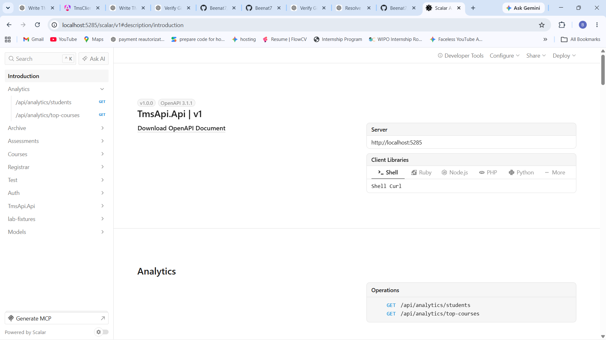
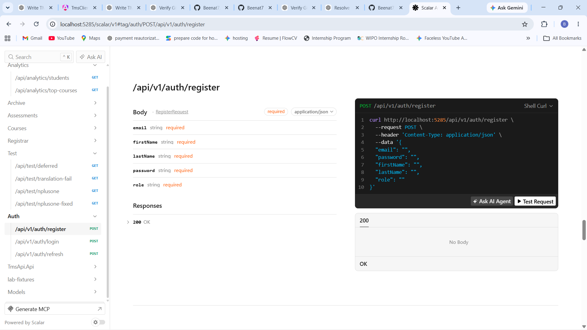
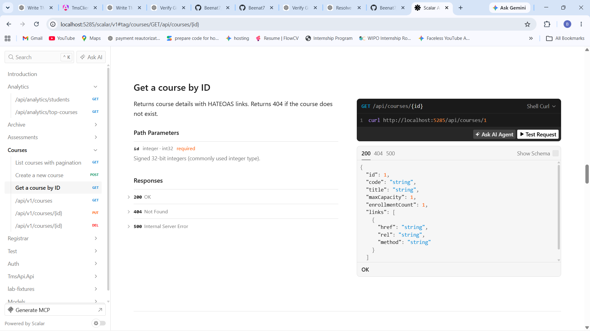
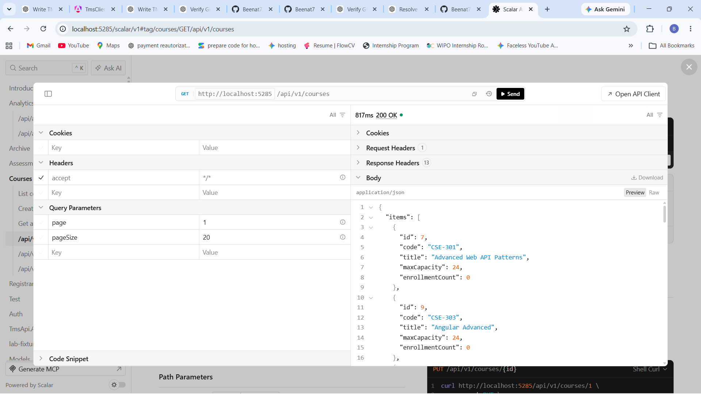
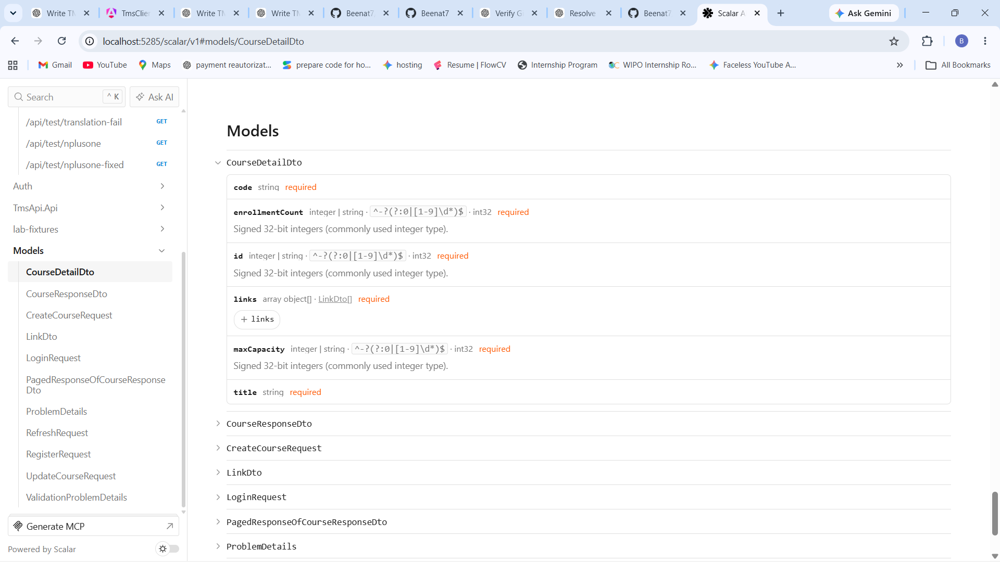
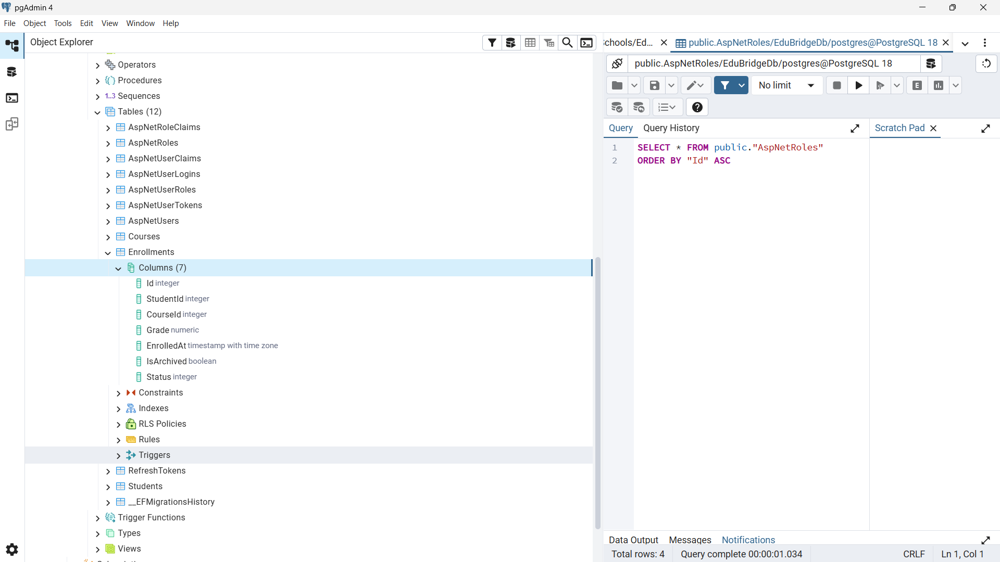
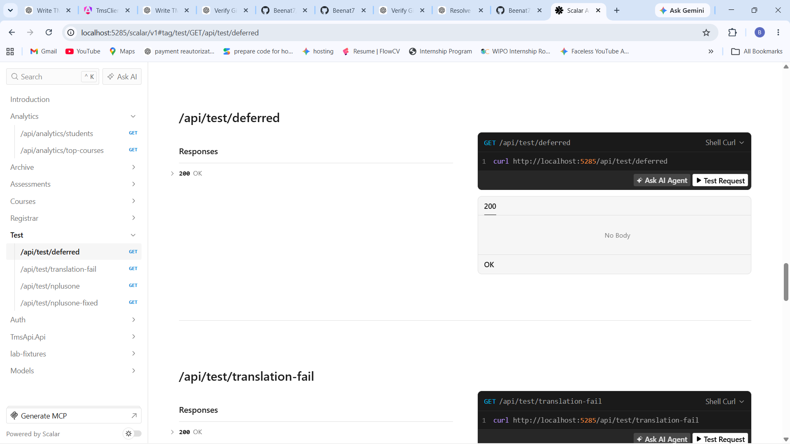

# TMS API — Training Management System

A backend Web API for the **Training Management System (TMS)**, built with **ASP.NET Core and C#**.

The project was developed incrementally throughout the training modules, progressing from ASP.NET Core fundamentals and database integration to RESTful API design, Clean Architecture, CQRS, caching, rate limiting, authentication, authorization, password hashing, and automated testing.

---

## 📌 Project Overview

The TMS API provides the backend services required by the Training Management System frontend.

It is responsible for:

* Managing courses and enrollments
* Persisting application data using PostgreSQL
* Exposing RESTful API endpoints
* Validating incoming requests
* Handling application errors consistently
* Implementing authentication and authorization
* Protecting sensitive endpoints
* Supporting caching and rate limiting
* Providing audit logging
* Integrating with the Angular frontend
* Maintaining automated tests

The application evolved throughout the training modules, with each module introducing additional backend engineering concepts and gradually improving the architecture.

---

## 🏗️ Architecture

The project follows **Clean Architecture** principles, separating responsibilities into different layers:

```text
TmsApi
├── API
│   ├── Controllers
│   ├── Filters
│   ├── Exception Handling
│   └── API Configuration
│
├── Application
│   ├── Commands
│   ├── Queries
│   ├── Handlers
│   ├── Validators
│   ├── Behaviors
│   └── Application Interfaces
│
├── Domain
│   ├── Entities
│   ├── Domain Models
│   └── Domain Rules
│
└── Infrastructure
    ├── Persistence
    ├── Entity Framework Core
    ├── PostgreSQL
    ├── Identity
    ├── Authentication
    └── External Infrastructure Services
```

The separation of concerns allows business logic, infrastructure concerns, and API concerns to evolve independently.

---

## ✨ Key Features

### ASP.NET Core Web API

* RESTful HTTP API
* Controller-based endpoints
* Dependency Injection
* Configuration using `appsettings.json`
* Environment-specific configuration
* API routing and endpoint organization

### Entity Framework Core & PostgreSQL

* Entity Framework Core for data access
* PostgreSQL database integration
* Entity relationships and configurations
* EF Core migrations
* Database seeding
* Query filtering and data persistence

### RESTful API Design

* Versioned API endpoints
* Standard HTTP methods and status codes
* Pagination
* Filtering
* API request/response DTOs
* Validation of incoming requests

### Clean Architecture

* Separation of API, Application, Domain, and Infrastructure layers
* Dependency inversion
* Application interfaces for infrastructure services
* Centralized application configuration

### CQRS & MediatR

The application uses the **CQRS (Command Query Responsibility Segregation)** pattern to separate read and write operations.

* Commands for state-changing operations
* Queries for retrieving data
* MediatR handlers
* MediatR pipeline behaviors
* Validation behavior
* Logging behavior
* Result-based application responses

### Error Handling

* Global exception handling
* Consistent API error responses
* `ProblemDetails`
* Custom exception handling
* Validation error handling

### Caching & Rate Limiting

* Server-side caching
* Hybrid caching
* Cache key organization
* Cache invalidation
* Rate limiting for API protection

### Authentication & Identity

* ASP.NET Core Identity
* Identity user configuration
* Password hashing
* Password validation policies
* Account lockout configuration
* JWT-based authentication
* Authentication and authorization configuration

### Full-Stack Integration

The API is integrated with the Angular TMS client through:

* CORS configuration
* Environment-based API configuration
* Cookie-based authentication
* XSRF/CSRF protection
* Credential handling

### Logging & Auditing

* Application logging
* Request logging
* Audit logging for API operations

### Automated Testing

* Backend unit/integration testing
* Test organization by application functionality
* Automated verification of API behavior

---

## 🧰 Tech Stack

| Technology                    | Purpose                       |
| ----------------------------- | ----------------------------- |
| **C#**                        | Backend programming language  |
| **ASP.NET Core**              | Web API framework             |
| **.NET 10**                   | Runtime and SDK               |
| **Entity Framework Core**     | ORM and data access           |
| **PostgreSQL**                | Relational database           |
| **MediatR**                   | CQRS and request handling     |
| **FluentValidation**          | Request validation            |
| **ASP.NET Core Identity**     | User and identity management  |
| **JWT Bearer Authentication** | API authentication            |
| **BCrypt.Net-Next**           | Password hashing              |
| **Scalar / OpenAPI**         | API documentation and testing |
| **xUnit / Testing tools**     | Automated testing             |

---

## 📚 Modules & Sessions Covered

This repository contains work completed across the following training sessions.

### Module 4 — ASP.NET Core

* **Session 1**
* **Session 2**
* **Session 3**

Introduced the ASP.NET Core Web API foundation, including application setup, controllers, dependency injection, configuration, and API fundamentals.

### Module 5 — Entity Framework Core & PostgreSQL

* **Session 1**
* **Session 2**
* **Session 3**

Introduced database development using Entity Framework Core and PostgreSQL, including:

* Entity Framework Core
* PostgreSQL integration
* DbContext
* Entity relationships
* Migrations
* Database operations
* Data seeding

### Module 6 — RESTful APIs

* **Session 1**
* **Session 2**
* **Session 3**

Focused on building and improving RESTful API endpoints, including:

* API endpoint design
* DTOs
* Validation
* Pagination
* Filtering
* API versioning
* REST API best practices

### Module 7 — Clean Architecture & Advanced Backend Patterns

* **Session 1**
* **Session 2**
* **Session 3**
* **Session 4**

Introduced advanced backend architecture and application patterns, including:

* Clean Architecture
* CQRS
* MediatR
* Result-based responses
* FluentValidation
* MediatR pipeline behaviors
* Global exception handling
* `ProblemDetails`
* Caching
* HybridCache
* Cache invalidation
* Rate limiting

### Module 10 — Full-Stack Integration

* **Session 1**
* **Session 2**
* **Session 3**

Focused on connecting the backend API with the Angular frontend, including:

* CORS
* Environment-based configuration
* Authentication cookies
* Credential handling
* XSRF/CSRF protection
* Frontend-backend authentication flow

### Module 11 — Password Hashing & Identity

* **Session 1**
* **Session 2**
* **Session 3**

Introduced authentication and identity concepts, including:

* Password hashing
* Salting
* ASP.NET Core Identity
* `IdentityUser`
* `IdentityDbContext`
* Password policies
* Account lockout
* JWT authentication

### Module 12 — Testing

* **Session 1**

Introduced backend automated testing and verification of application behavior.

---

## 📂 Project Structure

```text
TmsApi/
├── TmsApi.Api/
│   ├── Controllers/
│   ├── Filters/
│   ├── Exceptions/
│   ├── Mapping/
│   └── Program.cs
│
├── TmsApi.Application/
│   ├── Commands/
│   ├── Queries/
│   ├── Behaviors/
│   ├── Interfaces/
│   └── Validators/
│
├── TmsApi.Domain/
│   └── Entities/
│
├── TmsApi.Infrastructure/
│   ├── Persistence/
│   ├── Identity/
│   ├── Migrations/
│   └── Services/
│
└── tests/
    └── ...
```

> The exact structure may evolve as additional modules and features are implemented.

---

## ⚙️ Getting Started

### Prerequisites

Make sure the following are installed:

* **.NET 10 SDK**
* **PostgreSQL**
* **Git**
* An IDE such as **Visual Studio** or **Visual Studio Code**

### Clone the Repository

```bash
git clone https://github.com/Beenat7/TmsApi-M4.git
cd TmsApi-M4
```

### Configure the Database

Create a PostgreSQL database and configure the connection string in the appropriate environment configuration file.

Example:

```json
{
  "ConnectionStrings": {
    "DefaultConnection": "Host=localhost;Database=TmsDb;Username=postgres;Password=your_password"
  }
}
```

> Do not commit real passwords, secrets, or other sensitive credentials to the repository.

### Apply Database Migrations

Run:

```bash
dotnet ef database update
```

If the solution contains multiple projects, specify the appropriate infrastructure and startup projects as required.

### Run the API

```bash
dotnet run --project TmsApi.Api
```

The API will then be available at the local address displayed in the terminal.

---

## 🧪 Testing

The project includes automated tests for verifying backend functionality.

Run the test suite from the solution root:

```bash
dotnet test
```

This builds the solution and executes the configured test projects.

---

## 📖 API Documentation

When running in the development environment, the API documentation can be accessed through the configured OpenAPI/Scalar interface.

The available documentation interface depends on the configuration of the current project version.

---

## 📸 Screenshots

Screenshots can be included here to demonstrate the API and development environment.

### API Documentation



### Authentication



### Course



### Get Course



### Models



### Database



### Testing



---

## 🔗 Frontend

The TMS API is consumed by the Angular frontend application.

**TMS Client:**
*Add the GitHub repository link for the Angular frontend here.*

---

## 🎯 Project Goals

The main goal of the project is to develop a maintainable and scalable backend for a Training Management System while applying the concepts introduced throughout the training modules.

The project demonstrates the progression from basic Web API development to more advanced backend engineering practices, including:

* RESTful API development
* Database-driven application development
* Clean Architecture
* CQRS
* Authentication and authorization
* Secure password handling
* Caching
* Rate limiting
* Full-stack integration
* Automated testing

---

## 👩‍💻 Author

**Beenatlay Nigussie**

Computer Science Student | Full-Stack Developer

GitHub: [@Beenat7](https://github.com/Beenat7)
